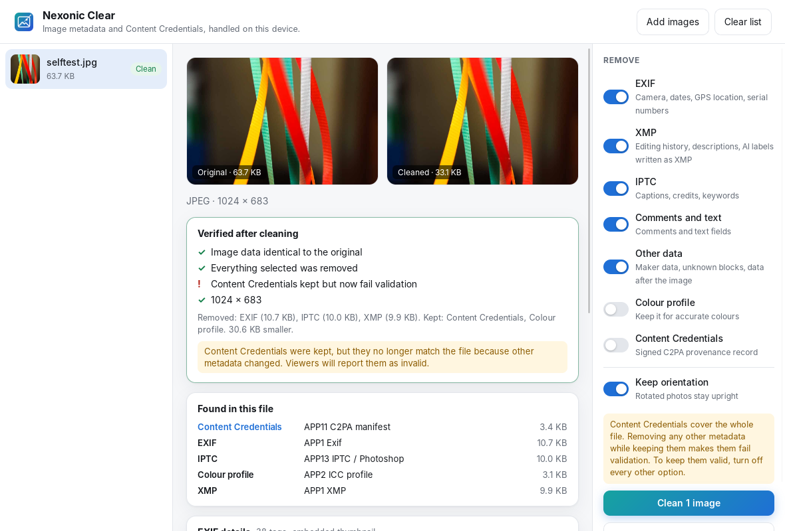

<p align="center"></p>
<h1 align="center">Nexonic Clear</h1>
<p align="center">Inspect and remove image metadata and Content Credentials. Offline, lossless, open source.</p>

<p align="center"></p>

## What it does

- **Inspects real files.** EXIF (camera, dates, GPS location, serial numbers), XMP, IPTC, ICC colour profiles, comments, unknown blocks and data hidden after the image.
- **Reads Content Credentials (C2PA).** Signer, signing time, the app that made the claim, recorded actions, and whether the credentials declare AI-generated content. Validation runs offline and reports exactly what the validator found.
- **Removes what you choose.** Each kind of metadata can be kept or removed. Content Credentials and colour profiles are kept unless you turn them off. Orientation can be kept so photos stay upright.
- **Strict, crash-safe parsing.** Damaged or malformed files are rejected with a clear message. PNG checksums and WebP structure are validated, and the parsers are fuzz-tested.
- **Never re-encodes.** Metadata is removed at the container level, so pixels, resolution, transparency, animation and colour data stay byte-for-byte identical.
- **Verifies every result.** Each output is parsed again and checked with SHA-256: image data identical to the original, kept embedded content identical, nothing selected left behind, and the state of any kept credentials.
- **Keeps motion photos and HDR intact.** Motion-photo videos, depth maps and Ultra HDR gain maps stored after the main image are detected and kept unless you choose to remove them, and their internal index is updated so they still work.
- **Folders and batches.** Drop files or whole folders (searched recursively) and clean them in one go. Results are stored on disk, not in memory, so large batches stay light on phones.
- **Safe saving.** Only results that pass verification can be saved. Desktop saves are atomic, so a file is never left half-written, and originals are never overwritten.
- **Private by design.** No network access, accounts, telemetry or ads. Files never leave your device.

Supported formats: JPEG, PNG and WebP (including animated PNG and WebP).

## Download

<p align="center">
  <a href="https://github.com/Shahrukhalid/Nexonic-Clear/releases/latest/download/NexonicClear-Windows-x64-Portable.zip"></a>
  <a href="https://github.com/Shahrukhalid/Nexonic-Clear/releases/latest/download/NexonicClear-macOS-AppleSilicon.zip"></a>
  <a href="https://github.com/Shahrukhalid/Nexonic-Clear/releases/latest/download/NexonicClear-macOS-Intel.zip"></a>
  <a href="https://github.com/Shahrukhalid/Nexonic-Clear/releases/latest/download/NexonicClear-Android-ARM64.apk"></a>
</p>

| Platform | Direct download |
| --- | --- |
| Windows 10/11 (x64), portable | [NexonicClear-Windows-x64-Portable.zip](https://github.com/Shahrukhalid/Nexonic-Clear/releases/latest/download/NexonicClear-Windows-x64-Portable.zip) |
| Mac with Apple Silicon (M1 and later) | [NexonicClear-macOS-AppleSilicon.zip](https://github.com/Shahrukhalid/Nexonic-Clear/releases/latest/download/NexonicClear-macOS-AppleSilicon.zip) |
| Mac with Intel | [NexonicClear-macOS-Intel.zip](https://github.com/Shahrukhalid/Nexonic-Clear/releases/latest/download/NexonicClear-macOS-Intel.zip) |
| Android (most phones, ARM64) | [NexonicClear-Android-ARM64.apk](https://github.com/Shahrukhalid/Nexonic-Clear/releases/latest/download/NexonicClear-Android-ARM64.apk) |
| Android (older phones, ARM32) | [NexonicClear-Android-ARM32.apk](https://github.com/Shahrukhalid/Nexonic-Clear/releases/latest/download/NexonicClear-Android-ARM32.apk) |

Nothing to install on desktop: unzip and run. Verify downloads with [SHA256SUMS.txt](https://github.com/Shahrukhalid/Nexonic-Clear/releases/latest/download/SHA256SUMS.txt). All versions are on the [Releases](https://github.com/Shahrukhalid/Nexonic-Clear/releases) page.

## Honest limits

- **Credentials are never forged or repaired.** A signature is shown as intact only when the C2PA validator says so. Trust lists are not bundled, so a valid signature means the file matches its credentials, not that the signer's identity is confirmed.
- **Content Credentials cover the whole file.** Removing any other metadata while keeping them makes them fail validation. The app warns before and reports after.
- **Removing metadata does not remove every trace.** Copies elsewhere, cloud provenance records, invisible watermarks and labels added by platforms are not affected. No tool can promise a platform will stop labelling an image.
- Builds are not code-signed yet. Windows SmartScreen and macOS Gatekeeper will ask for confirmation (on macOS: right-click the app, then Open).

## Build from source

Requirements: Rust (stable), Node.js 20+, and the [Tauri 2 prerequisites](https://tauri.app/start/prerequisites/) for your platform.

```bash
npm ci
cargo test -p clear-core      # engine tests on real image files
npm run tauri -- build --no-bundle
```

The engine (`crates/clear-core`) has no GUI dependencies and can be used on its own.

## License

MIT. Third-party licenses are listed in [THIRD_PARTY_NOTICES.md](THIRD_PARTY_NOTICES.md) and shipped with every build.
